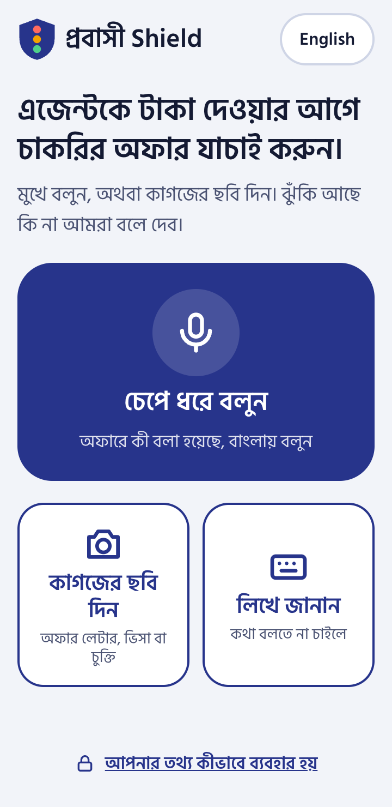
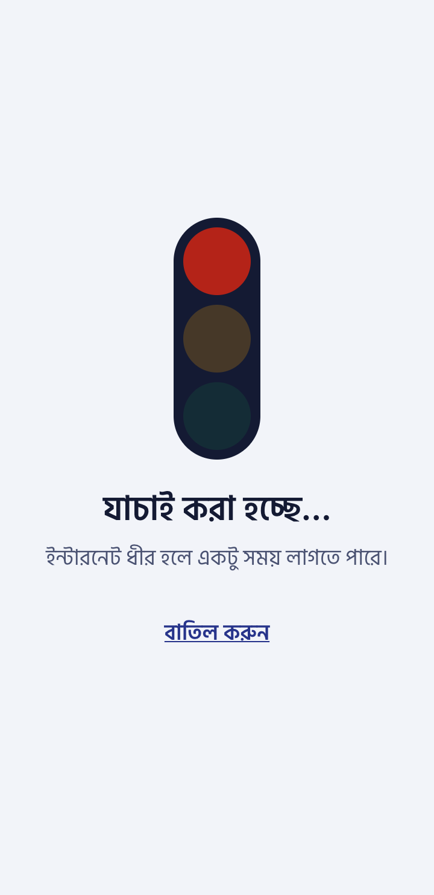
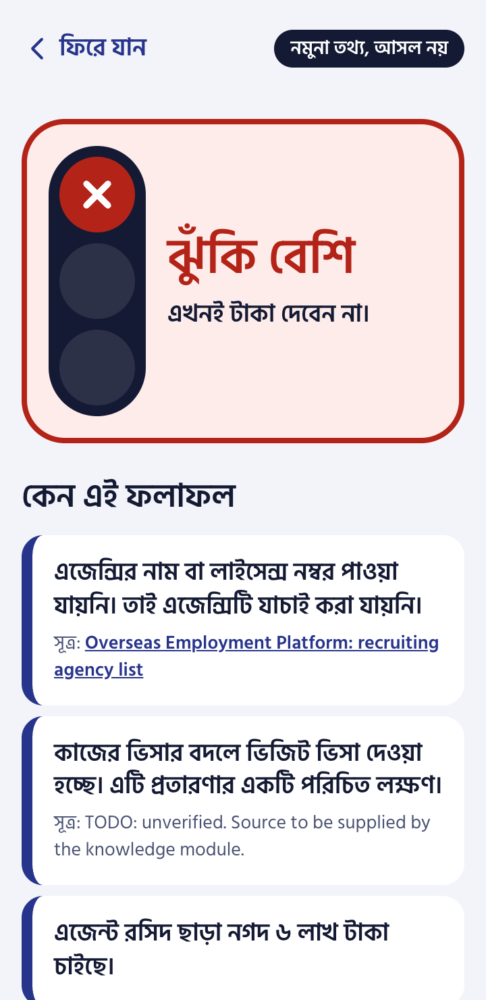
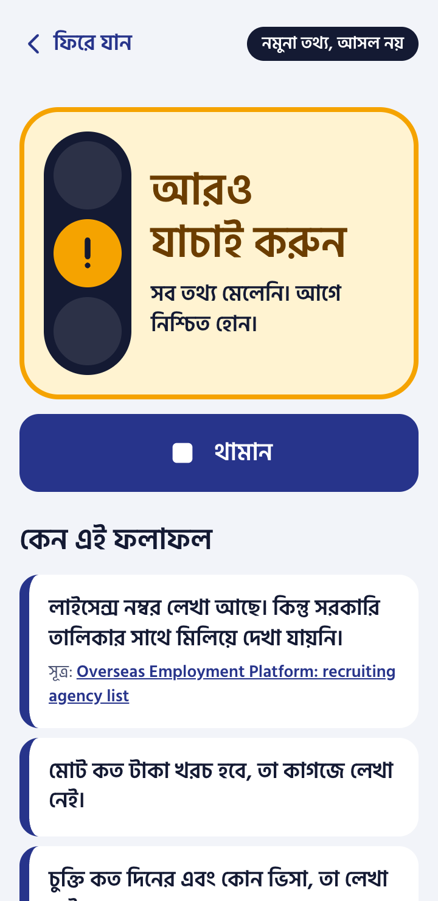
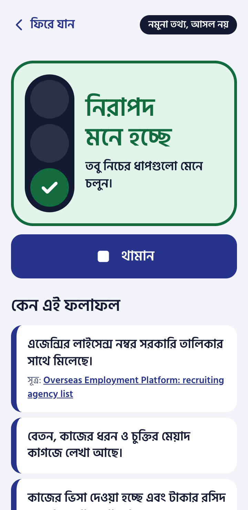
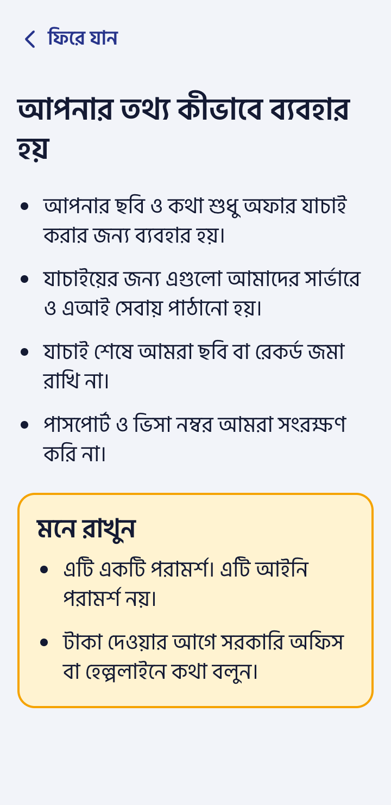

# Probashi Shield — frontend

Mobile-first web app (React, Vite, TypeScript, Tailwind) for checking a job offer before paying a recruiting agent. Bangla by default, with an English toggle. Installable as a PWA.

| Home | Checking | High risk | Check further | Looks safe | Privacy |
| --- | --- | --- | --- | --- | --- |
|  |  |  |  |  |  |

Screenshots are from a demo-mode build at 360 px wide.

## Run locally

Needs Node 20 or newer.

```bash
cd frontend
npm install
npm run dev        # http://localhost:5173
```

Other commands:

```bash
npm test           # Vitest + Testing Library
npm run build      # type-check, then production build into dist/
npm run preview    # serve dist/ locally, service worker included
```

## Environment variables

Vite reads them from the `.env` file at the **repo root** (see `.env.example` there), or from the shell. They are baked in at build time.

| Variable | Default | Meaning |
| --- | --- | --- |
| `VITE_API_URL` | empty (same origin) | Base URL of the backend. The app calls `POST {VITE_API_URL}/api/check`. |
| `VITE_DEMO_MODE` | `false` | `true` answers from bundled fixtures and enables the hidden demo menu. |

## Demo mode

```bash
VITE_DEMO_MODE=true npm run dev
```

In demo mode no request leaves the phone. Every check returns one of three fixtures in `src/fixtures/` (red, amber, green), shaped like `CheckResponse` in `probashi/schemas.py`.

- **Choosing the verdict:** tap the logo five times within three seconds. The menu offers red (the default), amber, green, and "live server", which switches back to the real API without a rebuild.
- **Offline pitch:** run `npm run build && npm run preview` (or the Docker image) and open the app once while online. The service worker then caches the whole app, fonts and fixtures included, so it keeps working with the network off.
- **Spoken answer:** the fixtures carry no `audio_base64`. The result screen then reads the answer with the device's own Bangla voice if it has one; if not, the listen button is hidden. Check this on the pitch device beforehand.
- Fixture results always show a "নমুনা তথ্য, আসল নয়" (sample data, not real) badge.

The fixtures are **synthetic**. Employer and agency names and licence numbers are marked as made up. The two helpline numbers (Probash Bondhu call centre, 16135 and +8809610102030) are real and were checked against [The Business Standard](https://www.tbsnews.net/node/490534) and [Dhaka Tribune](https://www.dhakatribune.com/bangladesh/293573/govt-launches-probash-bondhu-hotline-service-for). One reason in the red fixture has no source yet and says so.

## Docker

```bash
docker build -t probashi-frontend \
  --build-arg VITE_API_URL=https://api.example.org \
  --build-arg VITE_DEMO_MODE=false \
  frontend/
docker run -p 8080:80 probashi-frontend
```

The image serves `dist/` with nginx: hashed assets are cached for a year, the service worker and `index.html` are always revalidated.

## How it is put together

| Path | What it holds |
| --- | --- |
| `src/i18n/translations.ts` | Every piece of UI text, Bangla and English |
| `src/types.ts` | TypeScript mirror of `probashi/schemas.py` |
| `src/api.ts` | `checkOffer()`: multipart POST, timeout, error kinds |
| `src/compress.ts` | Client-side photo downscaling to under 2 MB |
| `src/demo.ts`, `src/fixtures/` | Demo mode |
| `src/components/SpeakButton.tsx` | Hold-to-speak recorder (MediaRecorder, 2 minute limit) |
| `src/components/VerdictCard.tsx`, `Signal.tsx` | The traffic-light verdict |
| `src/screens/` | Home, type, consent, loading and error, result, privacy, and the tools: guide, wages, SOS, helper, totals |
| `src/components/FollowUp.tsx`, `src/followUp.ts` | Follow-up questions and "add another paper" |
| `src/components/ReportScam.tsx` | Consented scam report |
| `src/storage.ts` | The only place that touches `localStorage` (prefix `probashi.`) |
| `src/lowData.ts`, `src/useGuide.ts`, `src/helper.ts`, `src/wages.ts`, `src/share.ts` | Low-data mode, cached country guide, helper tally, wage diary, share text |

Behaviour worth knowing:

- **Verdict** is shown three ways at once: lamp position and colour, a mark inside the lit lamp (cross, exclamation, tick), and words. A response whose level is not `red`, `amber` or `green` is treated as an error; the app never guesses a level.
- **Speaking:** hold the button and let go to send. A short tap also works: it starts recording, and a second tap sends. Recordings under one second are discarded.
- **Photo:** the file input has no `capture` attribute, so phones offer both the camera and the gallery (offers often arrive as WhatsApp images). Desktop gets a file picker.
- **Errors** are split into offline, timeout (90 s), server, bad request and unreadable answer, each with its own Bangla message and a retry button that resends the same input.
- **Documents are never stored:** recordings and photos live in memory only. `localStorage` holds the language, the consent answer, settings, the wage diary, the trusted contact, checklist ticks, the helper tally and the last country guide. "Delete everything" on the privacy screen removes all of it.
- **Size:** the first load is about 75 KB of JS and CSS gzipped plus two font weights; result, typing, privacy and demo screens load on demand.

## Features after the first verdict

| Feature | Where | How it works |
| --- | --- | --- |
| Consent | first check | Nothing is sent until the user agrees once. Demo answers never leave the phone, so they skip it. |
| Reading quality | result | One line from `guidance.confidence` (or `offer.confidence`): clear from 0.8, partly from 0.5, poor below. |
| "Why?" per reason | result | The rule behind the reason, its source, the date it was last checked, and a warning when the source is not an official one. |
| Follow-up questions | result | Up to three missing facts. Typed or spoken answers are sent with the first input and the check runs again. |
| Another paper | result | Adds a visa or contract photo (3 documents at most). The server compares the papers. |
| Questions for the agent | result | Listed from the reasons. |
| Complaint draft | result, red only | Bangla text with blanks, and a copy button. The app does not file anything. |
| Send to family | result | The phone's share sheet (Web Share), or the clipboard where there is none. |
| Print or save | result | `window.print()` with print styles: verdict, reasons, sources, the facts read and the time of the check. This is the evidence pack. |
| Scam report | result, red or amber | Sent only after the box is ticked: level, reason codes, country, agency name and licence. Never the document, voice or the user's name. |
| Country guide | result and "More help" | Rights, pre-departure checklist with ticks, payment advice, helplines. The last copy per country is kept for offline use. |
| Wage tracker | "More help" | Promised and received pay per month, with the total shortfall. Stays on the phone. |
| Emergency help | "More help" | Call a trusted contact, send the location by SMS or another app, official numbers for the chosen country. |
| Helper mode | "More help" | For people who check offers for others: counts red, amber and green on the phone, nothing else. |
| Totals | "More help" | The server's `/api/stats`: checks, verdicts, destinations, most common reason codes. |
| Checker accuracy | "More help" → Totals | The server's `/api/eval`: how many known fraud offers the engine called safe (target 0), how many it called red, and correct answers, with the split of real and made-up test cases. |
| Review queue | open the app at `#review` | For review staff, not linked from the app. Asks for the reviewer token, then lists the newest scam reports and the agencies named more than once. The token is held in memory only. |
| Low-data mode | automatic, or the switch in "More help" | On when the phone reports data saver or 2G. Photos are compressed to 600 KB and the server sends no audio; the phone's own Bangla voice reads the answer if it has one. |
| Offline retry | error screen | A check that failed without a connection is sent again when the phone is back online. It waits in memory only, so it is lost if the app is closed. |
| Too many checks | error screen | HTTP 429 gets its own "wait a minute" message. |

Limits to know:

- The guide, the totals and scam reports need the backend, so they show an error in demo mode with no server.
- The offline queue holds one check and does not survive closing the app. Persisting it would mean writing the user's document to the phone.
- Printing, the share sheet, the SMS link and location have no automated tests and were not tried on real phones.
- The red and amber fixtures carry sample `guidance`, labelled as sample text. The green one has none.
